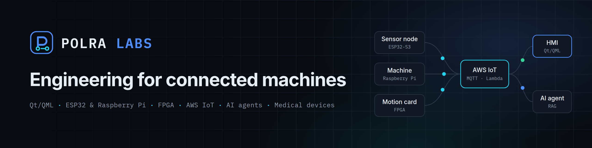
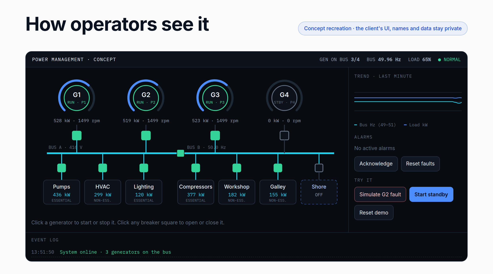
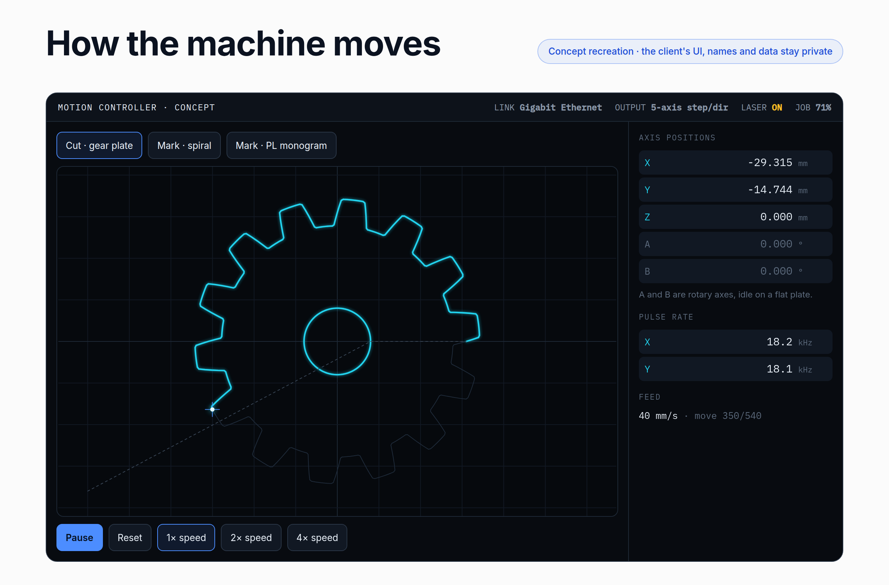
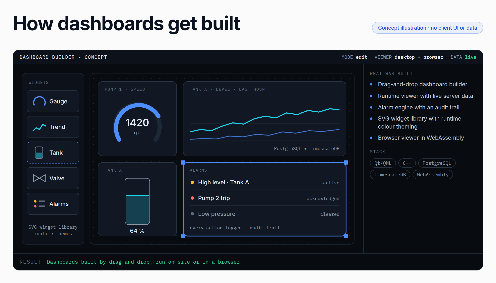
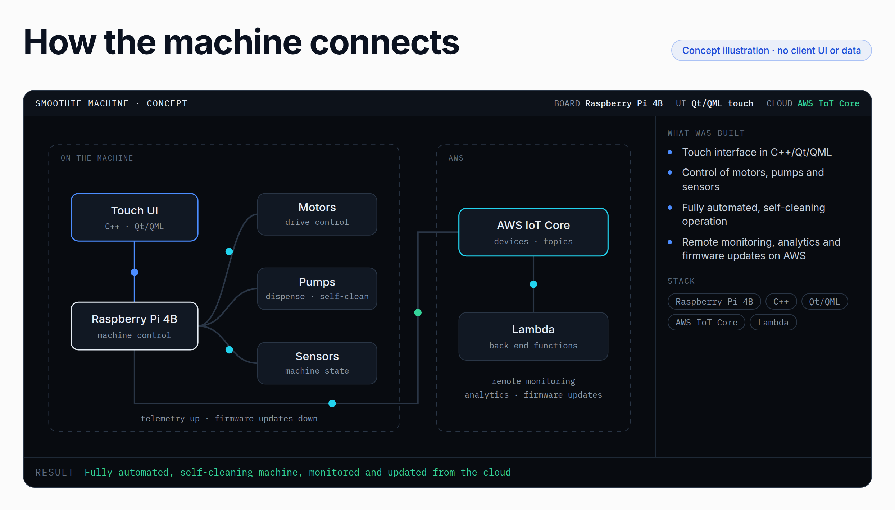
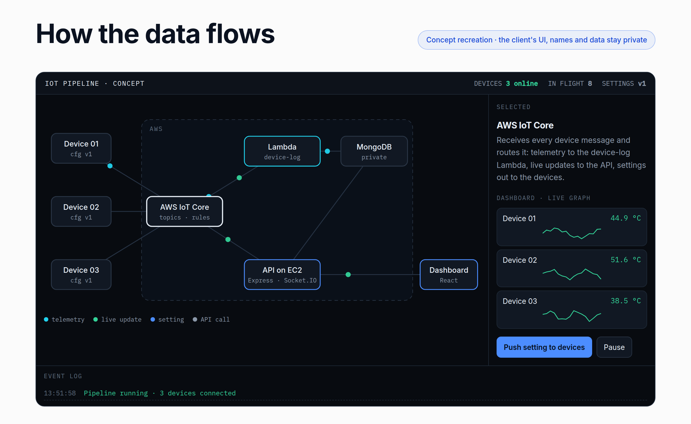
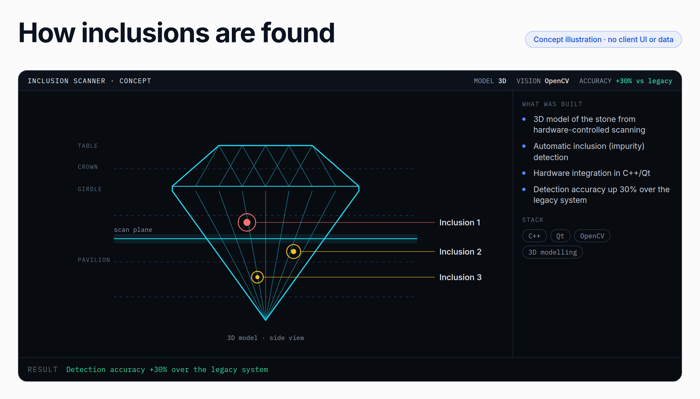
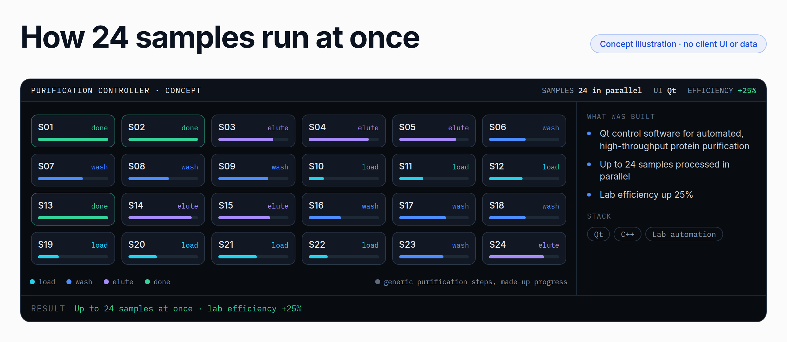

  

<h1 align="center">Polra Labs</h1>

<h3 align="center">
  Embedded, Qt/QML, IoT and AI software for medical, industrial and lab equipment
</h3>

  <strong>C++ | Qt 6 / QML | ESP32 | Raspberry Pi | FPGA / VHDL | AWS IoT | Python | AI agents</strong>

  &nbsp;&nbsp;
  &nbsp;&nbsp;
  

---

## About Us

**Polra Labs** designs and builds connected machines: embedded firmware, FPGA hardware, Qt/QML apps, cloud on AWS and Cloudflare, and AI agents for medical, industrial and lab equipment, backed by 15+ years of engineering. Founded by Bhavesh Polra.

> **About the code on this profile:** our client work is under NDA, so its source code stays private. Every screen below is a concept recreation drawn by us with made-up data. The client's UI, names and data stay private.

---

## What We Do

| Service | Description |
|:--------|:------------|
| **[Qt / QML applications](https://polralabs.com/services/qt-qml/)** | Desktop, embedded and mobile interfaces for machines: HMIs, device-control software, real-time dashboards and camera tools |
| **[ESP32 & Raspberry Pi](https://polralabs.com/services/esp32-raspberry-pi/)** | Firmware and embedded Linux for connected products: wireless sensor nodes, touch-screen appliances, OTA updates |
| **[FPGA & industrial MCUs](https://polralabs.com/services/fpga-industrial-mcus/)** | Motion-control hardware designed end to end: board design, VHDL logic, firmware and the PC software that drives it |
| **[AWS IoT](https://polralabs.com/services/aws-iot/)** | Device-to-cloud pipelines: secure MQTT telemetry, live dashboards, remote settings and firmware updates |
| **[Cloud: AWS and Cloudflare](https://polralabs.com/services/cloud/)** | Cloud architecture, migrations and edge hosting: one secure, manageable setup instead of scattered providers |
| **[AI agents](https://polralabs.com/services/ai-agents/)** | Agents and RAG systems that do real work: multi-step planning, document Q&A, tool calling, human approval |
| **[Medical devices](https://polralabs.com/services/medical-devices/)** | Software for medical, lab and surgical equipment, where safety, traceability and reliability come first |

---

## Tech Stack

**Languages & UI:**

  &nbsp;
  &nbsp;
  &nbsp;
  &nbsp;
  &nbsp;
  

**Embedded & hardware:**

  &nbsp;
  &nbsp;
  &nbsp;
  &nbsp;
  &nbsp;
  &nbsp;
  &nbsp;
  

**Cloud & data:**

  &nbsp;
  &nbsp;
  &nbsp;
  &nbsp;
  &nbsp;
  &nbsp;
  &nbsp;
  &nbsp;
  

**AI:**

  &nbsp;
  &nbsp;
  &nbsp;
  &nbsp;
  &nbsp;
  &nbsp;
  

**Vision & media:**

  &nbsp;
  &nbsp;
  

---

## Our Work

### Power Management & Alarm HMI: industrial power
Qt/QML operator HMI for a multi-generator plant: generator gauges, breakers, feeders, shore supply, priority control, alarms and trends, with a Python plant simulator for testing without hardware.

[Read the case study →](https://polralabs.com/work/power-management-hmi/)

---

### 5-Axis Motion Control Card: laser machines
FPGA motion-control card built end to end (board design, VHDL, firmware and the Qt PC software): 5-axis motion over Ethernet, a USB card variant, and galvo scanner control over XY2-100.

[Read the case study →](https://polralabs.com/work/motion-control-card/)

---

### SCADA Dashboard Builder & Viewer: industrial automation
Drag-and-drop builder and runtime viewer for real-time plant dashboards: an alarm engine with audit trail, themeable SVG widgets, PostgreSQL + TimescaleDB for time-series data, and a WebAssembly viewer that runs in the browser.

---

### Self-Cleaning Smoothie Machine: food tech
Fully automated, self-cleaning machine on a Raspberry Pi 4B: a C++/Qt/QML touch UI, motor, pump and sensor control, and AWS IoT Core + Lambda for remote monitoring, analytics and firmware updates.

---

### IoT Platform on AWS: industrial IoT
Device telemetry through AWS IoT Core and Lambda onto a live dashboard, and a migration from scattered providers to one secured AWS setup with user roles, one-time-code and Microsoft sign-in, and device management.

[Read the case study →](https://polralabs.com/work/iot-platform-aws/)

---

### Diamond Inclusion Detection System: computer vision
C++/Qt/OpenCV software that builds a 3D model of the stone with hardware-controlled scanning and finds the impurities in it. Detection accuracy up 30% over the legacy system.

---

### Protein Purification Controller: lab automation
Qt/C++ control software for automated, high-throughput protein purification of up to 24 samples in parallel. Lab efficiency up 25%.

---

### Medical Device Software
Application and embedded software for a medical device. The client, the device and its screens are under NDA, so there is no screenshot here.

---

**More projects** on [polralabs.com/work](https://polralabs.com/work/): a mixed-signal verification debugger (EDA), video streaming and recording desktop apps, an IEC-104 multi-device telemetry client, a gemstone angle inspection station, a surgical machine control GUI, a document Q&A agent (LangGraph, hybrid search), and customer-support AI chatbots (response time down 40%).

---

## Work With Us

- **End-to-end product delivery:** from proposal and architecture to development and deployment
- **Technical architecture & advisory:** for product teams building connected devices
- **AWS cloud consulting:** infrastructure and application design, migration, security and cost optimisation
- **DevOps automation:** infrastructure as code, CI/CD, monitoring, centralised logging and tracing

**Industries:** medical devices · industrial automation · laser machines · lab automation · diamond industry · food tech and IoT appliances

---

  &nbsp;&nbsp;
  

  <strong>Polra Labs</strong>: engineering for connected machines

